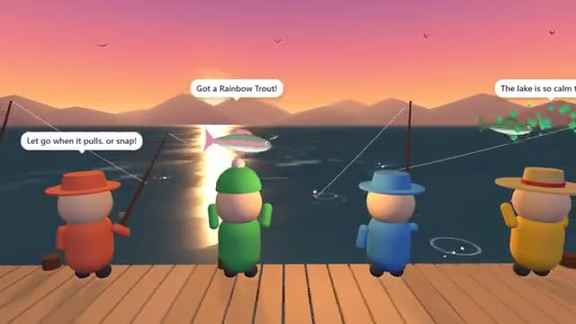

# Chill Fishing

Cast at sunset. Reel in something rare. A multiplayer starter game from [Multiplayer Agent](https://multiplayeragent.com): 3D, drop-in, 2–16 players, with friendly bots that fish beside you.

## How it plays

Hold to cast and let go at full power: far casts reach rarer fish. Tap when the bobber dunks, then hold to reel and let go whenever the fish pulls, or the line snaps. Twelve fish to collect, from Reed Minnows to the Moonfin.

**Controls:** Hold Space, click or the CAST button to cast and reel; A/D or ◀ ▶ to change spots; Enter to chat, 1 to 4 for emotes.

## Make it yours in the Game Builder

Open the [Game Builder](https://multiplayeragent.com), choose **Start from a starter game** and pick Chill Fishing. It opens as version 1 in your studio, ready to play and publish. Then ask for changes, for example:

- Add a shop that sells better rods with the fish you catch
- Make it a frozen lake with ice-fishing holes
- Add a weekly fishing contest for the biggest catch

## Run it yourself

1. Get a free publishable key (`pk_…`) at [multiplayeragent.com](https://multiplayeragent.com).
2. In `index.html`, put it in place of `pk_REPLACE_ME` in the `MP_CONNECT` block.
3. Serve the folder (for example `npx serve`) and open it. The 3D engine loads as a module, which browsers block from a file on disk.

Without a key it still runs, offline with the bots.

## How it is built

- One `index.html` plus three.js in `libs/`. The comment at the top of the script maps the code and explains the multiplayer.
- The fish are drawn in code (one canvas routine), so there are no image files. Add a species by adding a line to `FISH`.
- **Saves:** Your fish log (every species you've caught and your biggest of each) is saved for next time.
- **Leaderboard:** Each player's heaviest fish.
- **Bots:** Friendly bots fish, chat and cheer on the dock until people arrive.
- **Live sync:** Everyone sees each other cast, reel, emote and hold up their catch.
- **Live ops:** Raise the odds of rare fish (`rareBoost`) or give more time to hook (`biteWindowMs`) without touching the code; running events show at the top of the screen.
- `?attract` runs it offline with bots only. The preview video is recorded from it.

## License

MIT. three.js in `libs/` is MIT too (Copyright 2010-2024 three.js authors).
